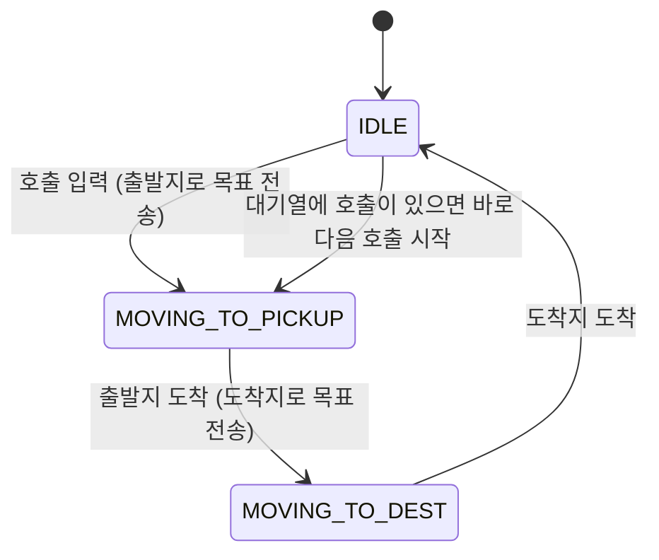

# Autoware 셔틀 호출 노드 (shuttle v2)

충북대 캠퍼스 자율주행 셔틀 프로젝트(speedwagon)의 셔틀 운행 로직입니다.
터미널에서 **"출발지 도착지"** 를 입력하면 차량이 출발지로 가서 승객을 태우고(픽업), 도착지까지 데려다줍니다.
Autoware의 **Planning Simulator**와 기본 샘플 맵 위에서 동작하며, 이동 중 들어온 호출은 대기열에 쌓였다가 순서대로 처리합니다.

## 주요 기능

- 호출 입력 (`1 5` 형식): 출발지 → 도착지 운행
- 선입선출(FIFO) 호출 대기열: 운행 중 들어온 호출은 대기열에 저장, 현재 운행이 끝나면 다음 호출 처리
- Autoware ADAPI 사용: 목표 전송, 자율주행 모드 전환, 경로 상태(도착) 감지
- 사전에 정의한 5개 지점(정문, 기타, 남문, 중앙, 동문) 좌표로 운행

## 동작 방식



1. 호출 `출발지 도착지`를 입력합니다. 차량이 쉬는 중(`IDLE`)이면 바로 시작하고, 운행 중이면 대기열에 추가합니다.
2. 출발지 좌표를 `/planning/mission_planning/goal`로 보내고, 3초 뒤 `/api/operation_mode/change_to_autonomous`로 자율주행 모드로 전환합니다.
3. `/api/routing/state`가 `ARRIVED`가 되면 출발지에 도착한 것으로 보고 도착지 좌표를 보냅니다.
4. 도착지에 도착하면 `IDLE`로 돌아가 대기열의 다음 호출을 시작합니다.

도착 여부는 1초마다 `check_arrival()`로 확인합니다.

## 지점 번호

| 번호 | 이름 |
|---|---|
| 1 | 정문 |
| 2 | 기타 |
| 3 | 남문 |
| 4 | 중앙 |
| 5 | 동문 |

좌표(`x`, `y`)와 방향(`qz`, `qw`)은 코드 상단의 `LOCATIONS`에 있습니다. 좌표는 Autoware 샘플 맵(`sample-map-planning`) 기준입니다.

## 요구 사항

- Ubuntu + ROS 2 (Autoware가 지원하는 배포판)
- [Autoware](https://autowarefoundation.github.io/autoware-documentation/) 빌드 완료
- Autoware 샘플 맵 (`~/autoware_map/sample-map-planning`)
- 사용하는 메시지: `geometry_msgs/PoseStamped`, `autoware_adapi_v1_msgs` (`ChangeOperationMode`, `RouteState`)

## 실행 방법

### 1. 시뮬레이터 실행 (터미널 A)

```bash
source ~/autoware/install/setup.bash
ros2 launch autoware_launch planning_simulator.launch.xml \
  map_path:=$HOME/autoware_map/sample-map-planning \
  vehicle_model:=sample_vehicle \
  sensor_model:=sample_sensor_kit
```

`map_path`에는 `~` 대신 `$HOME`을 써야 합니다.

### 2. 초기 위치 설정

RViz 툴바의 **2D Pose Estimate**(P 키)로 차량을 차선 위에 올려 둡니다. 클릭한 채 드래그해서 방향도 차선 방향과 맞춥니다.

### 3. 셔틀 노드 실행 (터미널 B)

```bash
source ~/autoware/install/setup.bash     # autoware_adapi_v1_msgs 때문에 필요
python3 shuttle_v2.py
```

conda 같은 가상환경이 켜져 있으면 ROS 파이썬 패키지를 못 찾을 수 있으니 시스템 파이썬으로 실행하세요.

## 사용법

프롬프트에 `출발지 도착지` 번호를 입력합니다.

```
호출 (출발지 도착지, 예: 1 5): 1 3
[INFO] [shuttle_node]: 목적지 전송: 정문
[INFO] [shuttle_node]: 자율주행 모드 전환 성공, 이동 시작
...
[INFO] [shuttle_node]: 정문 픽업 완료, 목적지로 출발
[INFO] [shuttle_node]: 목적지 전송: 남문
[INFO] [shuttle_node]: 남문 도착, 정차
```

운행 중에 추가로 호출하면 대기열에 쌓입니다.

```
호출 (출발지 도착지, 예: 1 5): 2 1
[INFO] [shuttle_node]: 기타 -> 정문 요청을 대기열에 추가
```

잘못된 입력은 다음 메시지가 나옵니다.

| 입력 | 메시지 |
|---|---|
| 번호 두 개가 아님 | `형식이 맞지 않습니다. 예: 1 5` |
| 없는 지점 번호 | `알 수 없는 지점 번호입니다.` |
| 출발지와 도착지가 같음 | `출발지와 목적지가 같습니다.` |

## 코드 구조

| 부분 | 역할 |
|---|---|
| `LOCATIONS` | 지점 번호별 이름과 목표 좌표/방향 |
| `ShuttleNode.call_shuttle()` | 호출 검증, 대기열 추가 또는 즉시 시작 |
| `ShuttleNode.start_trip()` | 출발지로 이동 시작 (`MOVING_TO_PICKUP`) |
| `ShuttleNode.send_goal()` | 목표 전송 후 자율주행 전환 |
| `ShuttleNode.check_arrival()` | 1초마다 도착 감지, 상태 전환, 대기열 처리 |
| `main()` | 입력 스레드와 ROS 스핀 구성 |

## 알려진 한계

- **한 번에 한 호출만 처리**합니다. 같은 방향 호출이 여러 건이어도 함께 태우지 않습니다.
- 대기열은 **선입선출**이라 가까운 호출을 먼저 처리하지 않습니다.
- 이동 중에는 새 호출에 반응하지 않고 현재 운행이 끝난 뒤에 처리합니다.
- 목표 전송 후 **고정 3초**를 기다리고 자율주행 전환을 한 번만 시도합니다. 실패하면 재시도하지 않아, 상태가 `MOVING_TO_PICKUP`에서 풀리지 않고 이후 호출이 대기열에만 쌓입니다.
- 출발지 도착 시 정차하지 않고 곧바로 도착지로 출발합니다.
- 비상정지 명령이 없고, 로그(`self.log`)는 메모리에만 저장됩니다.
- 샘플 맵의 차선은 방향별로 하나라서 **반대 방향 호출은 큰 루프를 돌아서** 갑니다.

## 문제 해결

| 증상 | 확인할 것 |
|---|---|
| `자율주행 모드 전환 실패: The target mode is not available` | Autoware가 자율주행 모드를 거부한 상태입니다. 궤적이 나오는지 확인: `ros2 topic hz /planning/scenario_planning/trajectory`, 자율주행 가능 여부: `ros2 topic echo /api/operation_mode/state --once` (`is_autonomous_mode_available`). 노트북 부하가 크면 RViz의 PointCloud Map 표시를 끄세요. |
| `operation_mode 서비스를 찾을 수 없습니다.` | 셔틀 노드를 띄운 터미널에서 `source ~/autoware/install/setup.bash` 를 했는지, 시뮬레이터가 완전히 뜬 뒤인지 확인 |
| 경로가 안 생기고 멈춤 | 지점이 차선 위에 있는지, 방향이 차선 방향과 맞는지 확인. `ros2 topic echo /api/routing/state` 로 경로 상태 확인 |
| 맵이 안 뜸 | `map_path`에 `~`를 썼는지 확인 |

지점 좌표를 새로 따려면 RViz의 **2D Goal Pose**로 원하는 위치를 찍고, 목표 토픽을 echo해서 `x`, `y`, `qz`, `qw`를 `LOCATIONS`에 옮기면 됩니다.

```bash
ros2 topic echo /planning/mission_planning/goal
```

## 향후 계획

- 호출을 동시에 여러 건 태우는 다중 승객 처리와 점수 기반 호출 선택
- 정류장 정차(승하차 대기), 비상정지, 자율주행 전환 실패 시 재시도와 경고
- 이동 중 재경로와 경로 위 정류장에 먼저 정차
- 반대 차선 지점 추가로 양방향 운행
- CARLA 시뮬레이터에 적용
